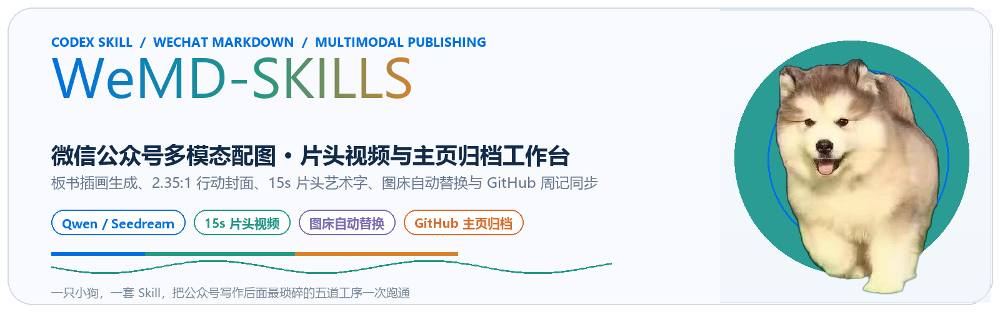
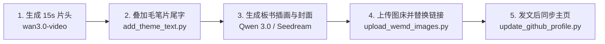
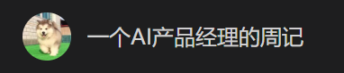

<p align="center">
  <a href="https://github.com/leeoisaboy/WeMD-SKILLS">
    
  </a>
</p>

<p align="center">
  
  
  
  
  
</p>

<h1 align="center">WeMD-SKILLS</h1>

<p align="center"><strong>给微信公众号 Markdown 文章配齐板书插画、2.35:1 封面、15 秒片头视频、自动图床上传与 GitHub 主页归档的 Codex Skill。</strong></p>

---

## 这个工具解决什么问题

用 Markdown 写公众号文章时，正文写完往往只完成了一半。真正耗时间的是后面那一串琐碎工序：给每节配风格统一的中文插画、做一张 2.35:1 的推送封面、剪一段十几秒的片头视频、把本地图片逐张传到图床并替换链接，发完文章还要顺手更新个人主页的归档列表。

`WeMD-SKILLS` 把这些步骤收进一套可直接调用的脚本和 Codex Skill 规范里，配合开源的公众号 Markdown 排版工具 [tenngoxars/WeMD](https://github.com/tenngoxars/WeMD) 使用：你写好正文，其余配图、视频、图床和发文后归档都可以按固定流程一路跑完。

## 完整工作流



| 环节 | 做什么 | 对应脚本 | 备用 / 说明 |
| :--- | :--- | :--- | :--- |
| **15 秒片头视频** | 生成无文字的 16:9 电影感开场视频 | `scripts/generate_article_videos.py` | 默认 `wan3.0-video`，失败自动回退 `happyhorse-1.1-t2v` |
| **片尾主题艺术字** | 用毛笔字体渲染中文主题与标题，淡入叠到片尾 | `scripts/add_theme_text.py` | 规避视频模型写中文乱码的问题 |
| **板书插画与封面** | 按期固定一种板书材质生成插画，另出 2.35:1 封面 | `scripts/generate_qwen_images.py` | 默认 `qwen-image-3.0`，备用 `Seedream 5.0`，最后兜底 HTML 渲染 |
| **图床上传与替换** | 自动上传 `img.wemd.app` 并改写 Markdown 链接 | `scripts/upload_wemd_images.py` | 同目录写入 `wemd_upload_cache.json`，重复运行不重传 |
| **GitHub 主页归档** | 公众号群发后，把永久链接插到 Profile 周记列表首位 | `scripts/update_github_profile.py` | 首屏保留最新 5 篇，更早文章自动折叠收纳 |

---

## 快速开始

### 1. 安装到 Codex

克隆或下载本仓库，将整个目录放到 Codex 的 skills 目录下：

- **Windows**：`C:\Users\<用户名>\.codex\skills\wemd-article-diagrams`
- **macOS / Linux**：`~/.codex/skills/wemd-article-diagrams`

然后安装 Python 依赖：

```bash
pip install -r requirements.txt
```

### 2. 配置环境变量

在运行前配置所需的 API Key（仅用环境变量传入，不要写进代码或仓库）：

```powershell
# 生图与视频主用（阿里云百炼）
$env:DASHSCOPE_API_KEY = "你的百炼 Key"

# 生图备用（火山引擎 Ark，可选）
$env:ARK_API_KEY = "你的火山 Ark Key"

# 发文后同步 GitHub Profile（可选，也支持直接用 gh auth login）
$env:GITHUB_TOKEN = "你的 GitHub Token"
```

### 3. 两种使用方式

- **在 Codex 中直接对话触发**：安装完成后，直接告诉 Codex「用 `wemd-article-diagrams` 给这篇 `week18.1.md` 配图并上传图床」，Codex 会按照 [SKILL.md](SKILL.md) 里的完整规范自动执行。
- **在终端里分步手动运行**：也可以按下面章节单独调用任意一个脚本。

---

## 分步使用说明

### 第一步：生成 15 秒片头并叠加片尾文字

所有媒体按期存放在文章同级的周目录（如 `week18.1/`）下。先生成 15 秒无字片头：

```bash
python scripts/generate_article_videos.py \
  --prompt "<15秒片头分镜描述，末尾留出干净空白区域>" \
  --out-dir week18.1 \
  --name-prefix week18.1_opening \
  --duration 15 \
  --resolution 720P \
  --ratio 16:9
```

再用毛笔字体把本期主题句和文章标题淡入叠到视频结尾（`--text` 用 `|` 分行）：

```bash
python scripts/add_theme_text.py \
  --video week18.1/week18.1_opening.mp4 \
  --text "借别人的鲁棒性|解自己的数据荒" \
  --fade-start 11.8 \
  --fade-duration 2.4 \
  --y-center 0.32
```

本地预览时可在 Markdown 开头插入 `<video>` 标签；发布到公众号时，再在公众号后台上传该 MP4 替换即可。

### 第二步：生成板书插画与 2.35:1 封面

默认使用 `qwen-image-3.0` 生成正文插画（`1024*1024`），每张递增 `--index`：

```bash
python scripts/generate_qwen_images.py \
  --prompt "<中文板书插画描述>" \
  --out-dir week18.1 \
  --name-prefix week18.1 \
  --index 1 \
  --size 1024*1024
```

生成微信公众号推送封面（`2.35:1`，`1692*720`）：

```bash
python scripts/generate_qwen_images.py \
  --prompt "<明亮、行动导向的封面描述，不含文字>" \
  --out-dir week18.1 \
  --name-prefix week18.1_cover \
  --index 1 \
  --size 1692*720
```

<details>
<summary>展开查看备用生图方案（Seedream 5.0 与 HTML 兜底）</summary>

当 Qwen 不可用时，切换到火山引擎 Seedream 5.0：

```bash
python scripts/generate_seedream_images.py \
  --prompt "<中文插画描述>" \
  --out-dir week18.1 \
  --name-prefix week18.1 \
  --count 4 \
  --response-format b64_json
```

仅当 Qwen 与 Seedream 同时不可用时，使用 HTML 透明概念图渲染器兜底：

```bash
python scripts/render_html_diagrams.py \
  --html week18.1/week18.1_concept_diagrams.html \
  --out-dir week18.1
```

</details>

### 第三步：上传图床并替换 Markdown 链接

先在文章 Markdown 里用相对路径引用本地图片：

```markdown

```

运行上传脚本后，图片会自动上传到 `img.wemd.app`，文章里的本地路径会被原地替换为在线链接：

```bash
python scripts/upload_wemd_images.py week18.1.md
```

### 第四步：公众号发文后，顺手同步到 GitHub 主页

文章在微信后台群发拿到永久链接后，运行一条命令即可把它插到 GitHub Profile README 的周记列表第一行（首屏保留最新 5 篇，更早的自动收进折叠抽屉，不会丢失）：

```bash
python scripts/update_github_profile.py \
  --url "https://mp.weixin.qq.com/s/<permanent-id>" \
  --md week18.1.md \
  --summary "<一句话核心观点>"
```

如果不方便传 `--md`，也可以直接传 `--title "<文章标题>"` 和 `--date 2026-11-21`；如果想先看改动效果再推送，加上 `--dry-run` 即可。

---

## 真实落地效果

<p align="center">
  
</p>

本仓库生成的所有板书插画、封面图和 15 秒片头，都会直接用在公众号 **「一个AI产品经理的周记」** 中。微信搜索公众号名称即可查看配合 WeMD 排版后的真实成片效果与每期完整周记。

---

## 目录结构

```text
WeMD-SKILLS/
├── SKILL.md                             # Codex Skill 规范、画风记录与写作约束
├── agents/
│   └── openai.yaml                      # Skill 元数据配置
├── assets/
│   ├── 公众号图片.png                    # 公众号展示图
│   └── week3_concept_diagrams.html      # HTML 兜底渲染样式基线
├── scripts/
│   ├── generate_article_videos.py       # 15 秒片头视频（wan3.0-video / HappyHorse）
│   ├── add_theme_text.py                # 片尾毛笔主题字叠加
│   ├── generate_qwen_images.py          # Qwen Image 3.0 文生图（主用）
│   ├── generate_seedream_images.py      # Seedream 5.0 文生图（备用）
│   ├── render_html_diagrams.py          # HTML 透明概念图渲染（最后兜底）
│   ├── upload_wemd_images.py            # 上传 img.wemd.app 并替换链接
│   └── update_github_profile.py         # 发文后同步周记到 GitHub Profile
├── requirements.txt
├── .gitignore
└── README.md
```

## 安全与致谢

- **密钥安全**：所有 API Key 与 GitHub Token 均通过环境变量、`--api-key` 参数或本地被 `.gitignore` 忽略的文件读取，仓库内不保存任何密钥。
- **配套工具**：本工作流配套使用开源微信公众号 Markdown 编辑器 [tenngoxars/WeMD](https://github.com/tenngoxars/WeMD)，感谢原作者的开源贡献。
- **License**：MIT
